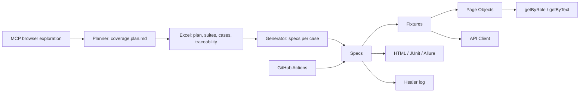

# Playwright SQA Framework

[](https://github.com/sharif-jobayed/playwright-qa-framework/actions/workflows/ci.yml)

End-to-end UI and REST API test automation in TypeScript for [saucedemo.com](https://www.saucedemo.com).
The suite was rebuilt from a manual test plan: browser exploration with Playwright MCP, the Playwright
planner workflow, an Excel artifact set, then generator/healer-driven automation aligned case by case.

## What this repo proves

- **Manual QA foundations**: written test plan, five suites, 29 traceable cases, exploratory charters.
- **Automation design**: Page Object Model, fixtures, typed data, no selectors inside specs.
- **Playwright preferred locators**: `getByRole`, `getByText`, `getByLabel`; a class selector only to
  scope a product card that has no ARIA role.
- **TypeScript discipline**: strict mode, `tsc --noEmit` clean.
- **API testing**: schema checks, status codes, negative cases, auth token validation, payload echo.
- **Cross-browser**: same UI specs run in Chromium and Firefox.
- **CI/CD**: GitHub Actions matrix runs UI + API suites on every push and PR.
- **Reporting**: Playwright HTML, JUnit XML, Allure results.
- **Healer discipline**: failures diagnosed and fixed at source; no retry loops, no `test.fixme()`.

## Stack

| Layer | Choice | Why |
| --- | --- | --- |
| Runner | Playwright Test 1.65.1 | One runner for UI and API, built-in parallel execution |
| Language | TypeScript (strict) | Type safety in page objects and fixtures |
| UI under test | saucedemo.com | Public demo with stable DOM and published credentials |
| API under test | JSONPlaceholder, DummyJSON | Public REST APIs, no setup cost |
| Manual artifacts | `artifacts/manual-testing/*.xlsx` | Editable plan, suites, cases, traceability, defect log |
| CI | GitHub Actions | Free for public repos, no local runner needed |
| Reports | HTML, JUnit, Allure | Human readable + machine consumable |

No Docker required. No paid services. Runs on Debian 13 with Node 24.

## Structure

```text
playwright-qa-framework/
├── .github/workflows/ci.yml       # CI matrix: chromium, firefox, api
├── artifacts/manual-testing/
│   └── SauceDemo-Manual-Test-Artifacts.xlsx
├── specs/
│   ├── coverage.plan.md           # planner output: scenarios, steps, expectations
│   └── healer-log.md              # failures, root causes, fixes
├── scripts/generate-manual-artifacts.py  # rebuilds the workbook, stdlib only
├── src/
│   ├── api/ApiClient.ts           # typed wrapper over APIRequestContext
│   ├── data/                      # users, products, prices, checkout data
│   ├── fixtures/test-fixtures.ts  # page objects + authenticated session
│   └── pages/                     # BasePage, Login, Inventory, Cart, Checkout, Menu
├── tests/
│   ├── api/                       # users API, auth API
│   └── ui/                        # auth, catalog, cart, checkout, navigation
├── playwright.config.ts
├── tsconfig.json
└── package.json
```

## Architecture



## Manual testing workflow

1. **Explore.** Playwright MCP opened saucedemo.com, read credentials from
   `div.login_credentials_wrap-inner`, and mapped login, catalogue, cart, checkout and menu flows.
2. **Plan.** Playwright planner agent produced `specs/coverage.plan.md` with independent scenarios,
   explicit steps, test data and expected results.
3. **Artifacts.** `scripts/generate-manual-artifacts.py` writes the Excel workbook:
   - `Test Plan` — objective, scope, entry/exit criteria, risks, locator policy.
   - `Test Suite` — five suites with priority and automation status.
   - `Test Cases` — 29 cases with ID, preconditions, steps, data, expected result, spec file.
   - `Traceability` — case ID to spec file and test title.
   - `Defect Log` — ready-to-use logging template.
   - `Exploratory` — four timeboxed charters for out-of-scope areas.
4. **Generate.** Each automated case has a matching test title `TC-*` in `tests/ui`.
5. **Heal.** First Chromium run exposed two bad expectations. `specs/healer-log.md` records both
   root causes and fixes. Plan and Excel were corrected alongside the code.

## Suite map

| Suite ID | Name | Cases | Automated |
| --- | --- | --- | --- |
| SUITE-01 | Authentication | 6 | 6 |
| SUITE-02 | Product catalogue | 6 | 6 |
| SUITE-03 | Cart | 5 | 5 |
| SUITE-04 | Checkout | 8 | 8 |
| SUITE-05 | Session and navigation | 4 | 2 (2 manual/exploratory) |

Credentials and demo users live in `src/data/users.ts`. Product names, prices and expected totals
live in `src/data/checkout.ts`.

## Run locally

```bash
# 1. Install dependencies
npm ci

# 2. Install browsers if not already present
npx playwright install chromium firefox

# 3. Typecheck
npm run typecheck

# 4. All suites
npm test

# 5. One suite
npm run test:ui
npm run test:api

# 6. Rebuild manual artifacts
npm run artifacts

# 7. Open the HTML report
npm run report
```

Override targets with environment variables:

```bash
BASE_URL=https://staging.example.com API_BASE_URL=https://api.example.com npm test
```

Filter by tag or case ID:

```bash
npx playwright test --grep @smoke
npx playwright test --grep TC-CHK-06
```

## Design decisions

1. **Manual first.** No automated case exists without a written case ID, steps and expected result.
2. **Fixtures over `beforeEach`.** `loggedInInventory` gives each test a fresh authenticated page.
3. **User-facing locators.** `getByRole`/`getByText` keep specs readable and resilient to markup refactors.
4. **Class selectors only for scoping.** Product cards and price/name collections have no ARIA role;
   every action inside them still uses `getByRole`.
5. **Data lives in `src/data`.** Test inputs are readable and reusable; credentials never appear inside specs.
6. **Soft assertions for request logging.** `ApiClient` attaches a non-fatal status check so a 5xx is
   visible without masking the real failure.
7. **Retries only in CI.** Local runs fail fast. CI retries twice to absorb public-demo flakiness.
8. **Separate `api` project.** API specs do not launch a browser; CI runs them as a distinct job.

## Current scope

- 54 tests: 48 UI (24 cases × Chromium + Firefox), 6 API.
- 29 manual cases; 27 automated, 2 exploratory/manual.
- 3 projects: `chromium`, `firefox`, `api`.
- Public targets only; no credentials beyond public demo accounts.

## Honest limitations

- Public demo apps can change without notice. CI retries absorb brief instability, not a redesign.
- Dynamic Catalog demos, `About` navigation and PDF output are exploratory/manual only.
- JSONPlaceholder does not persist writes; POST tests verify echo and 201, not database state.
- No SQL coverage yet. No Docker, no database seeding, no visual regression. Deliberate scope:
  readable, runnable evidence of QA skills rather than architecture theatre.
