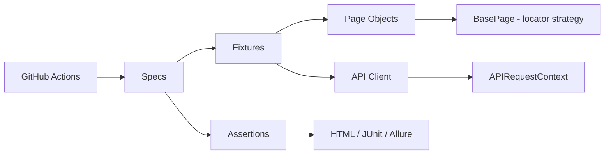

# Playwright SQA Framework

[](https://github.com/sharif-jobayed/playwright-qa-framework/actions/workflows/ci.yml)

End-to-end UI and REST API test automation in TypeScript. Built as a portfolio-grade framework: Page Object Model, shared fixtures, data-driven tests, typed API client, three Playwright projects, CI workflow, and three report formats.

## What this repo proves

- **Automation design**: reusable page objects, one locator strategy, no selectors in specs.
- **TypeScript discipline**: strict mode, typed fixtures, typed data models, `tsc --noEmit` clean.
- **API testing**: schema checks, status codes, negative cases, auth token validation, payload echo verification.
- **Cross-browser**: same specs run in Chromium and Firefox.
- **CI/CD**: GitHub Actions matrix runs UI + API suites on every push and PR.
- **Reporting**: Playwright HTML, JUnit XML, Allure results.
- **Test hygiene**: isolated sessions via fixtures, retries only in CI, traces and screenshots on failure.

## Stack

| Layer | Choice | Why |
| --- | --- | --- |
| Runner | Playwright Test 1.65.1 | One runner for UI and API, built-in parallel execution |
| Language | TypeScript (strict) | Type safety in page objects and fixtures |
| UI under test | [saucedemo.com](https://www.saucedemo.com) | Public demo app with stable `data-test` attributes |
| API under test | [JSONPlaceholder](https://jsonplaceholder.typicode.com), [DummyJSON](https://dummyjson.com) | Public REST APIs, no setup cost |
| CI | GitHub Actions | Free for public repos, no local runner needed |
| Reports | HTML, JUnit, Allure | Human readable + machine consumable |

No Docker required. No paid services. Runs on Debian 13 with Node 24.

## Structure

```text
playwright-qa-framework/
├── .github/workflows/ci.yml     # CI matrix: chromium, firefox, api
├── src/
│   ├── api/ApiClient.ts         # typed wrapper over APIRequestContext
│   ├── data/                    # users, products, checkout data
│   ├── fixtures/test-fixtures.ts# page objects + authenticated session
│   └── pages/                   # BasePage, Login, Inventory, Cart, Checkout
├── tests/
│   ├── api/                     # users API, auth API
│   └── ui/                      # login, cart, checkout
├── playwright.config.ts
├── tsconfig.json
└── package.json
```

## Architecture



## Run locally

```bash
# 1. Install dependencies
npm ci

# 2. Install browsers (already present on most dev machines)
npx playwright install chromium firefox

# 3. Typecheck
npm run typecheck

# 4. All suites
npm test

# 5. One suite
npm run test:ui
npm run test:api

# 6. Open the HTML report
npm run report
```

Override targets with environment variables:

```bash
BASE_URL=https://staging.example.com API_BASE_URL=https://api.example.com npm test
```

## Design decisions

1. **Fixtures over `beforeEach`.** `loggedInInventory` gives each test a fresh authenticated page. No shared state, no test-order dependency.
2. **Locators live in page objects.** A UI change means one edit in one file, not edits across every spec.
3. **Data lives in `src/data`.** Test inputs are readable and reusable; credentials never appear inside specs.
4. **Soft assertions for request logging.** `ApiClient` attaches a non-fatal status check; tests then assert exact expected status, so a 5xx is visible without masking the real failure.
5. **Retries only in CI.** Local runs fail fast. CI retries twice to absorb public-demo flakiness.
6. **No retry loops for flaky UI.** Waits are explicit via Playwright assertions. A flaky test is treated as a defect in test code.
7. **Separate `api` project.** API specs do not launch a browser; CI runs them as a distinct job.
8. **Tag strategy.** `@smoke`, `@e2e`, `@api` allow future filtering: `npx playwright test --grep @smoke`.

## Current scope

- 26 tests: 20 UI (Chromium + Firefox), 6 API.
- 3 projects: `chromium`, `firefox`, `api`.
- Public targets only; no credentials beyond public demo accounts.

## Honest limitations

- Public demo apps can change without notice. CI retries absorb brief instability, not a redesign.
- JSONPlaceholder does not persist writes; POST tests verify echo and 201, not database state.
- No SQL coverage yet. That is the next planned addition.
- No Docker, no database seeding, no visual regression. Deliberate: the goal is readable, runnable evidence of core QA automation skills, not architecture theatre.
